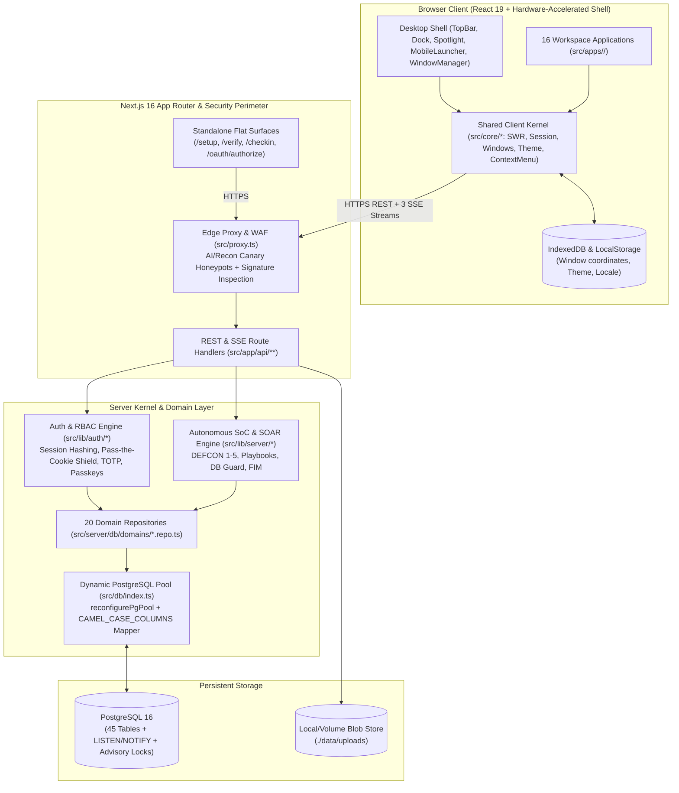

# Orbit Community OS — System Architecture

**Orbit Community OS** is a modular, full-stack digital community operating system and collaborative web-desktop engineered from scratch by **tetha42**. Built on **Next.js 16 (App Router)**, **React 19**, and **PostgreSQL 16**, the system combines a hardware-accelerated desktop window compositor with 16 user-facing workspace applications (plus an internal media preview window), a three-channel real-time Server-Sent Events (SSE) bus, an Autonomous Security Operations Center (**SoC Pro Studio**), and a **Zero Config Files** runtime architecture.

---

## Table of Contents

1. [High-Level Architectural Topology](#1-high-level-architectural-topology)
2. [Directory Structure & Module Boundaries](#2-directory-structure--module-boundaries)
3. [Zero-Config Runtime Configuration (`sistem_ayarlari` & In-Memory State)](#3-zero-config-runtime-configuration-sistem_ayarlari--in-memory-state)
4. [App Router & Modular Mini-App Registry](#4-app-router--modular-mini-app-registry)
5. [Core Kernel Modules (`src/core/*`)](#5-core-kernel-modules-srccore)
6. [In-Memory SWR Data Layer & Request Deduplication](#6-in-memory-swr-data-layer--request-deduplication)
7. [60/120fps Hardware-Accelerated Window Compositor](#7-60120fps-hardware-accelerated-window-compositor)
8. [Real-Time Event Bus (`LISTEN/NOTIFY` & Triple-Stream SSE)](#8-real-time-event-bus-listennotify--triple-stream-sse)
9. [RBAC Permission Engine & Zero-Trust Guards](#9-rbac-permission-engine--zero-trust-guards)
10. [Pure Modules & Compile-Time Verification](#10-pure-modules--compile-time-verification)
11. [Data Architecture & Source-of-Truth Ownership](#11-data-architecture--source-of-truth-ownership)

---

## 1. High-Level Architectural Topology

Orbit Community OS is structured as a **single-package modular monolith**:



### Two Foundational Invariants

1. **The Server Enforces Every Boundary:** Client-side permission checks (`canUseApp`, `canManageApp`) exist purely for ergonomic UI rendering (hiding unauthorized Dock icons or management buttons). Every API route independently validates authentication, 2FA enrollment, IP session binding, and per-app RBAC permissions via `requireApp(request, appId, level)`.
2. **Zero External State Dependencies:** PostgreSQL 16 serves as both the primary transactional relational store and the real-time pub/sub message broker (`LISTEN/NOTIFY`), eliminating the need for external Redis or message queue clusters.

---

## 2. Directory Structure & Module Boundaries

```text
/
├── src/
│   ├── app/                  # Next.js 16 App Router (Pages, Standalone Surfaces & API Routes)
│   │   ├── api/              # 31 domain API route groups (/api/auth, /api/soc, /api/kurulum, ...)
│   │   ├── dogrula/          # Public cryptographic certificate & document verification (/verify)
│   │   ├── kurulum/          # Zero-Config First-Run Web Setup Wizard (/setup)
│   │   ├── oauth/            # OAuth 2.0 / OIDC authorization & consent UI (/oauth/authorize)
│   │   ├── yoklama/          # Standalone event QR & 6-digit code check-in UI (/checkin)
│   │   ├── globals.css       # Semantic CSS custom properties & adaptive theme tokens
│   │   ├── layout.tsx        # Root HTML shell, zero-flash theme boot script & global providers
│   │   └── page.tsx          # Primary Web-Desktop entry point & setup status gate
│   ├── apps/                 # 16 self-contained workspace applications
│   │   ├── <app-id>/         # Isolated module: manifest.ts + index.tsx + components/ + hooks/
│   │   ├── loaders.gen.ts    # Auto-generated dynamic import loaders (DO NOT EDIT MANUALLY)
│   │   └── registry.gen.ts   # Auto-generated manifest registry (DO NOT EDIT MANUALLY)
│   ├── components/           # Desktop shell & shared presentation components
│   │   ├── Auth/             # AuthPortal, FirstRunSetupWizard, RegisterForm, Legal Modals
│   │   ├── Common/           # DialogProvider, MacOSMenu, ModernAppIcon, HelpDialogs
│   │   ├── Desktop/          # Desktop canvas, lock screen, context menus
│   │   ├── Dock/             # Hardware-accelerated application Dock with hover prefetching
│   │   ├── MobileLauncher/   # Touch-optimized mobile home screen, action sheets & navigation
│   │   ├── NotificationCenter/# Real-time 4-tier notification panel
│   │   ├── TopBar/           # System menu bar, active app menus, status indicators
│   │   └── WindowManager/    # W3C Pointer Events window frame, titlebar & resize handles
│   ├── core/                 # Shared client/universal kernel modules (see Section 5)
│   ├── configs/              # Static workspace & menu configuration presets
│   ├── data/                 # Reference catalogs (e.g., disciplines & engineering tracks)
│   ├── db/                   # PostgreSQL connection pool, runtime reconfiguration, core schemas
│   ├── server/
│   │   └── db/
│   │       ├── schema.init.ts# Idempotent startup DDL & versioned schema migrations
│   │       └── domains/      # 20 domain-specific PostgreSQL repositories (*.repo.ts)
│   ├── lib/                  # Auth, WAF, SOAR playbooks, crypto, i18n dictionaries, rate limiters
│   ├── state/                # workspaceStore.tsx: thin composition wrapper over src/core/*
│   ├── types/                # Shared TypeScript interfaces
│   └── proxy.ts              # Global Edge WAF & AI/Recon Canary Honeypot interceptor
├── tools/
│   └── fim/                  # Go-based File Integrity Monitoring (FIM) scanner & baseline
├── scripts/                  # Build, code generation (gen-apps.mjs) & verification gates
├── tests/                    # End-to-end API, RBAC, audit & Playwright browser test suites
└── docs/                     # Canonical English engineering & user documentation
```

---

## 3. Zero-Config Runtime Configuration (`sistem_ayarlari` & In-Memory State)

Orbit Community OS eliminates mandatory `.env` or `config.ini` files in the repository. A freshly cloned instance boots cleanly even before a database is configured and guides the operator through the **Web UI Setup Wizard (`/setup`)**.

### How Zero-Config Boot Works

1. **Non-Crashing Startup Probe (`getKurulumDurumu`):**
   - When a user visits `/` or `/setup`, `GET /api/kurulum` invokes `checkDatabaseStatus()` and `getKurulumDurumu()` (`src/db/index.ts`).
   - If PostgreSQL is not yet configured or reachable, the server does not crash; it returns `{ hazir: false, firstRun: true, step: 'database' }` and renders the interactive setup wizard.
2. **Live Runtime Pool Reconfiguration (`reconfigurePgPool`):**
   - During Step 1 of `/setup`, the operator tests their PostgreSQL connection string via `POST /api/kurulum/test-db` (`testPostgresConnection`).
   - Upon completion (`POST /api/kurulum` or `POST /api/kurulum/complete`), `reconfigurePgPool(url)` dynamically drains any old pool, binds the new connection string in memory (`process.env.DATABASE_URL` and `CONFIG.database.url`), and immediately executes `ensurePostgresInit()` to create all 45 tables, indexes, and system roles within an advisory-locked transaction.
3. **Database-Backed System Settings (`sistem_ayarlari`):**
   - Studio identity (`universite` = `tetha42`), Community Name (`kulup_adi` = `Orbit Community`), Primary Domain (`kulup_domain` = `orbit.local`), leadership titles (`imza1_unvan`, `imza2_unvan`), default member role (`varsayilan_rol_id`), and AES-256-GCM encrypted SMTP credentials (`smtp_host`, `smtp_port`, `smtp_user`, `smtp_pass`, `smtp_from`) are persisted directly in the `sistem_ayarlari` PostgreSQL table (`src/db/schema.ts` & `src/server/db/domains/settings.repo.ts`).
   - Administrators can update any of these settings live at runtime from **System Settings → Community Identity** (`/api/settings/community`) or **System Settings → Mail & SMTP** without restarting the Node.js process or editing files on disk.

---

## 4. App Router & Modular Mini-App Registry

Every workspace application in Orbit Community OS lives in `src/apps/<id>/` and is defined by a strongly typed `manifest.ts` file (`AppManifest` in `src/core/apps/manifest.ts`).

### Declarative `manifest.ts` Contract

```ts
import type { AppManifest } from '@/core/apps/manifest';

const manifest = {
	id: 'projects',
	title: 'Projects',
	shortTitle: 'Projects',
	description: 'Community R&D showcase and repository hub',
	en: {
		title: 'Projects',
		shortTitle: 'Projects',
		description: 'Community R&D showcase and repository hub',
	},
	category: 'Engineering',
	icon: 'FolderGit2',
	accentColor: '#0a84ff',
	window: { width: 960, height: 640, x: 120, y: 70 },
	component: { module: './index', export: 'ProjectsApp' },
	permission: {
		ad: 'Projects',
		kullan: 'Browse R&D projects, view repositories, and star showcases.',
		yonet: 'Create, feature, edit, and archive community projects.',
	},
	notifications: {
		project_published: 'kullan',
	},
} as const satisfies AppManifest;

export default manifest;
```

### Automatic Code Generation (`scripts/gen-apps.mjs`)

Running `npm run gen:apps` (automatically invoked during `npm run dev`, `npm run build`, and `npm run verify`) scans `src/apps/*/manifest.ts` and generates two files:
- **`src/apps/registry.gen.ts`**: Synchronous metadata registry powering the Dock, Mobile Launcher, Spotlight search, TopBar application menus, RBAC Role Designer, and notification permission mappings.
- **`src/apps/loaders.gen.ts`**: Dynamic `import()` chunk factories mapped to each `appId`.

### Zero-Latency Chunk Prefetching (`prefetchApp`)

- **Desktop Dock Hover:** Moving the pointer over any Dock icon (`onMouseEnter`) triggers `prefetchApp(appId)`, downloading and parsing the application's JS chunk before the user finishes clicking.
- **Mobile Touch Start:** Touching an icon in `MobileLauncher` (`onTouchStart`) prefetches the bundle immediately.
- **Idle Pre-Warming:** When the browser main thread is idle (`requestIdleCallback`), Orbit automatically pre-warms the most frequently accessed applications (`events`, `teams`, `members`, `chat`).

---

## 5. Core Kernel Modules (`src/core/*`)

Shared functionality is written once inside `src/core/*` and imported by mini-apps. Mini-apps never import `@/state/workspaceStore` directly; they consume focused kernel hooks:

| Kernel Module | Exported Hooks & Utilities | Responsibility |
| :--- | :--- | :--- |
| `@/core/permissions` | `seviyeOf`, `canUse`, `canManage`, `yeterliMi`, `rolVerilebilirMi`, `usePermissions()` | Pure RBAC evaluation logic shared identically between server APIs and client UI |
| `@/core/session` | `SessionProvider`, `useSession()`, `useSessionEvent`, `useLiveEvent` | Authenticated user state, 2FA/Passkey flows, lock screen, and SSE lifecycle |
| `@/core/windows` | `WindowsProvider`, `useWindow(id)`, `useWindows()`, `useWindowActions()`, `useActiveApp()` | Multi-window state machine, z-index stacking, minimize/maximize, and focus routing |
| `@/core/data` | `useJsonResource(url)`, `sendJson`, `postAction`, `downloadBlob`, `downloadCsv`, `formatDate*` | In-memory SWR data fetching, mutations, safe CSV/Blob downloads, and date formatting |
| `@/core/commands` | `sendAppCommand`, `useAppCommand`, `emitAppEvent`, `useAppEvent`, `refreshAllResources` | Inter-app message bus and TopBar menu command dispatching |
| `@/core/shell` | `useShellState()`, `useShellActions()`, `useShell()`, `useContextMenu()` | Wallpaper, brightness, audio toggles, Spotlight, and unified desktop/touch context menus |
| `@/core/dock` | `useDock()` | Dock item filtering, badge aggregation, auto-hide calculation, and bottom-edge hover hotspot |
| `@/core/notifications` | `BILDIRIM_TURLERI` | Maps notification kinds to `(appId, minimumPermissionLevel)` directly from app manifests |
| `@/core/i18n` | `I18nProvider`, `useI18n()` (`t`, `language`, `setLanguage`, `getAppMeta`) | Bilingual localization engine (`en` and `tr`) with compile-time key parity verification |
| `@/core/theme` | `useTheme()`, `ThemeSync`, `themeBootScript`, `WALLPAPERS` | Light/Dark/System mode, 6 accent palettes, frosted glass toggle, and reduced motion |
| `@/core/persistence` | `useWorkspacePersistence()` | Asynchronous IndexedDB persistence (`macos_workspace_db`) for window positions and UI prefs |
| `@/core/shortcuts` | `useGlobalShortcuts()` | Global keyboard shortcuts (`Esc`, Spotlight, window cycling, manifest hotkeys) |
| `@/core/ui` | `ToastProvider`, `useToast()`, `Sheet`, `RoleBadge`, `ui.module.css` | Shared studio UI primitives, slide-over sheets, and toast notifications |
| `@/core/text` | `escapeHtml`, `initials` | XSS-safe HTML escaping for print/PDF views and avatar initial generation |

---

## 6. In-Memory SWR Data Layer & Request Deduplication

All client-side data fetching uses `useJsonResource<T>(url, options)` (`src/core/data/useJsonResource.ts`), an custom in-memory **Stale-While-Revalidate (SWR)** engine engineered for zero-flicker window switching:

1. **25-Second Freshness Window (`TTL`):** Cached responses remain fresh in memory for 25 seconds. Closing and reopening a mini-app window or switching tabs renders cached data synchronously on the first frame without loading spinners.
2. **Background Revalidation:** Stale entries are rendered immediately while a silent background `fetch` updates the cache and triggers a surgical React state transition only if the payload changed.
3. **Concurrent Request Deduplication:** If multiple components (e.g., TopBar badge, Dashboard widget, and an open Mini-App) request `/api/etkinlikler` simultaneously, `useJsonResource` coalesces them into a single in-flight HTTP request.
4. **Global Cache Invalidation (`refreshAllResources`):** When an SSE event signals a permission or data change, or when the user clicks **Refresh All Data**, all active resource hooks revalidate in parallel.

---

## 7. 60/120fps Hardware-Accelerated Window Compositor

The Orbit desktop shell (`src/components/WindowManager/` and `src/core/windows/`) is engineered to sustain locked 60fps/120fps frame rates even with multiple complex applications open simultaneously:

- **W3C Pointer Events Architecture:** Window dragging and 8-directional edge/corner resizing use unified W3C Pointer Events (`onPointerDown`, `onPointerMove`, `onPointerUp` with `setPointerCapture`), providing sub-pixel precision across both desktop mice/trackpads and touchscreens (12px edge hitboxes and 18px corner hitboxes).
- **Offscreen Rendering Culling (`content-visibility: hidden`):** When a window is minimized to the Dock, the compositor applies `content-visibility: hidden` to its subtree. The browser completely skips layout (reflow) and painting for minimized windows while preserving their live React state in memory.
- **GPU Compositor Layer Promotion:** Active dragging or resizing promotes the window frame to a dedicated GPU texture layer via `will-change: top, left, width, height` and strict layout containment (`contain: strict`), isolating the rest of the desktop from layout thrashing.
- **Zero-Cost Opaque Mode:** When **Transparency** is disabled in Theme Settings (default for maximum performance), `--glass-blur` resolves to `none`, completely removing all `backdrop-filter` passes across the entire DOM.

---

## 8. Real-Time Event Bus (`LISTEN/NOTIFY` & Triple-Stream SSE)

Orbit Community OS operates three specialized Server-Sent Events (SSE) pipelines backed by a single per-process PostgreSQL `LISTEN` connection (`src/db/olaylar.ts`):

```text
Domain Mutation (withTransaction)
  └──▶ olayYayinla(client, event) ──▶ pg_notify('orbit_events', payload) [Delivered on COMMIT]
                                              │
                     Single LISTEN Connection per Node.js Process
                       ├──▶ Invalidate Server Role Cache (5s TTL)
                       └──▶ Fan-out to Target User's /api/olaylar SSE Streams
                                              │
               Browser EventSource (src/core/session/live.ts)
                 └──▶ Re-probes /api/auth/me & /api/bildirimler
```

### The Three Real-Time Streams

1. **Workspace & Security Control Bus (`/api/olaylar` — Channel: `orbit_events`):**
   - Delivers targeted lifecycle events (`yetki-degisti` for live RBAC role updates, `oturum-sonlandi` for remote session revocation or SOAR lockdown, and `bildirim` for new notifications and unread chat alerts).
   - Enforces a maximum of 8 concurrent SSE streams per user (`KULLANICI_BASINA_AZAMI_BAGLANTI`), evicting the oldest stream when a 9th tab opens.
   - Payloads carry **only identifiers**, never sensitive data; the client fetches the updated resource through authenticated endpoints that enforce RBAC.
2. **Real-Time Chat Stream (`/api/chat/stream` — Channel: `chat_events`):**
   - Streams instant room messages (`new_message`), typing indicators (`typing`), poll updates, and emoji reactions (`reaction`) to open Chat windows.
3. **SoC Telemetry & SIEM Stream (`/api/soc` — Channel: `soc_stream`):**
   - Streams high-frequency security telemetry, WAF blocks, Canary honeypot triggers, and FIM integrity alerts to **SoC Pro Studio**.
   - **Backpressure Buffering (`requestAnimationFrame`):** `SocContext.tsx` buffers incoming SSE telemetry events in a micro-task queue and flushes them at most once per display refresh frame (`requestAnimationFrame`), preventing React render storms during DDoS or brute-force simulations. When the browser tab is hidden (`document.hidden`), telemetry rendering automatically throttles down.

---

## 9. RBAC Permission Engine & Zero-Trust Guards

Full details of the authentication and security architecture are covered in **[`docs/AUTH_SECURITY.md`](AUTH_SECURITY.md)**. From an architectural standpoint:

- **Three Permission Levels per Mini-App:** Every role grants `yok` (None), `kullan` (Use), or `yonet` (Manage) to each of the 16 workspace applications (`src/core/permissions/index.ts`).
- **Centralized Route Guard (`requireApp`):** Every mini-app API handler begins with:
  ```ts
  const auth = await requireApp(request, 'events', 'yonet');
  if (!auth.authorized) return auth.response;
  ```
- **Permission-Filtered Search & Notifications:**
  - `/api/bildirimler` inspects `BILDIRIM_TURLERI` (derived from each app's `manifest.ts`) and queries only notification sources where `can(user, appId, requiredLevel)` evaluates to `true`.
  - `/api/search` executes cross-domain search queries strictly across mini-apps and records the caller's role is authorized to view.
- **Zero-Trust DB Studio Guard (`x-db-token`):** Even super-administrators must complete a secondary 2FA challenge (`/api/database/auth`) to obtain a short-lived `x-db-token` before querying or inspecting tables in DB Studio.

---

## 10. Pure Modules & Compile-Time Verification

To guarantee architectural integrity without requiring a live browser or database for unit checks, core business logic is isolated into **Pure Modules** (zero `@/` path aliases, zero side effects, executed directly by Node's native TypeScript strip runner via `scripts/check-pure.mjs`):

- `src/core/permissions/index.ts` — RBAC lattice math, privilege escalation prevention (`fazlaYetkiler`, `rolVerilebilirMi`).
- `src/core/notifications/kinds.ts` — Notification-to-permission mapping.
- `src/core/theme/pure.ts` — Theme preference parsing and zero-flash boot script parity.
- `src/lib/rateLimit.ts` — Sliding-window rate limiter state machine.

Every commit and CI run executes `npm run verify` (`make verify`), which runs:
1. `node scripts/gen-apps.mjs` — Regenerates and verifies mini-app registries.
2. `tsc --noEmit` — Full strict TypeScript 5.9 typecheck.
3. `eslint .` — Architectural boundary and code quality linting.
4. `node scripts/check-pure.mjs` — Pure module unit assertions.
5. `node scripts/check-i18n.mjs` — Strict parity check between English (`en`) and Turkish (`tr`) localization keys.
6. `node scripts/check-tokens.mjs` — CSS design token compliance check.
7. `node scripts/check-audit-coverage.mjs` — Verification of 100% audit logging coverage across mutation routes.

---

## 11. Data Architecture & Source-of-Truth Ownership

To prevent data drift and architectural ambiguity, every domain in Orbit Community OS has an explicit single source of truth, designated service owner, and derived cache boundary.

### Source-of-Truth Domain Ownership

| Domain | Owning Table / Service | Service Owner | Derived Caches & Replicas | Lifetime / Invalidation |
|---|---|---|---|---|
| **Identity & Authentication** | `users` | `src/lib/auth/`, `src/db/identity.ts` | In-memory session cache | Token TTL (30d), invalidated on logout or password/2FA reset |
| **Community Settings** | `system_settings` | `src/db/settings.ts` | In-memory settings cache, fallback to `SYSTEM_SETTINGS_DEFAULTS` | Invalidated on `sistem_ayarlari` update; synced to clients |
| **Roles & Permissions** | `roles`, `role_permissions` | `src/db/roles.ts` | `roller_raw` cache in `src/lib/server/cache.ts` | Invalidated immediately on role create/update/delete |
| **Community Identity & Showcase** | `teams`, `projects` | `src/server/db/domains/projects.repo.ts`, `teams.repo.ts` | Direct DB queries + SWR client cache | Revalidated on SSE `orbit_events` (`yetki-degisti`, etc.) |
| **Events & Attendance** | `events`, `event_registrations`, `attendances` | `src/server/db/domains/events.repo.ts` | SWR client cache | Revalidated on poll/SSE and mutate |
| **Financial Kasa** | `budget_records` | `src/server/db/domains/budget.repo.ts` | Real-time SSE `butce_guncellendi` | Immediate cross-tab broadcast via SSE bus |
| **Governance & Minutes** | `decisions` | `src/server/db/domains/decisions.repo.ts` | SWR client cache | Invalidated on mutate |
| **Audit & Accountability** | `audit_logs` | `src/db/audit.ts`, `src/lib/audit/withAudit.ts` | Immutable append-only; 730-day retention prune | Write-through on every HTTP mutation |
| **Client Desktop State** | `user_workspace_preferences` & `IndexedDB` | `src/core/persistence/*`, `src/app/api/profile/workspace` | **Hybrid Local-Cloud Roaming**: Instant sub-millisecond startup from local IndexedDB with background cloud roaming from `user_workspace_preferences` | Auto-synced upon mutation; roaming across laptops/devices on login |

### Hybrid Workspace Synchronization Policy

Client-side desktop preferences (active wallpaper, window coordinates, dock pinned apps, volume, brightness, and dock auto-hide) utilize a **Hybrid Local-Cloud Architecture**:
1. **Sub-millisecond Zero-Flicker Startup:** On initial page load, the shell instantly hydrates from local browser `IndexedDB`.
2. **Cloud Roaming Across Devices:** When authenticated, `useWorkspacePersistence` synchronizes with `/api/profile/workspace` backed by PostgreSQL's `user_workspace_preferences` table. A member signing in on a new laptop or smartphone immediately inherits their customized desktop layout, pinned applications, and active wallpaper.
3. **Graceful Offline Fallback:** If disconnected, all workspace customizations persist locally in client `IndexedDB` and synchronize to the cloud once network connectivity is re-established.

