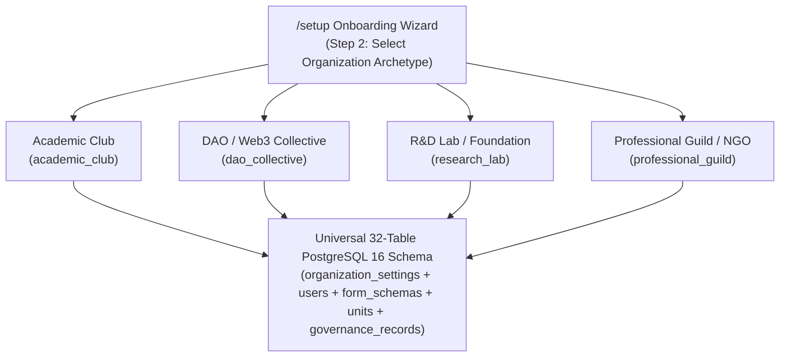

# Orbit Community OS — Universal Data Platform & Architecture Roadmap (v3.0)

> **Status:** Canonical v3.0 Architecture Specification  
> **Scope:** Organization Archetypes, 32-Table Consolidated PostgreSQL Schema, Embedded Microservice Mini-App Isolation, Zero-Friction Localization (`translations JSONB`), and Governance Lifecycle.  
> **Companion Specifications:** [`DATA_DICTIONARY.md`](./DATA_DICTIONARY.md) · [`DATABASE.md`](./DATABASE.md) · [`ARCHITECTURE.md`](./ARCHITECTURE.md)

---

## Table of Contents

1. [Core Product & Architectural Decisions](#1-core-product--architectural-decisions)
2. [Architectural Invariants](#2-architectural-invariants)
3. [Universal Community OS Model: 4 Organization Archetypes](#3-universal-community-os-model-4-organization-archetypes)
4. [Schema Consolidation: From Legacy Tables to 32 Pure English Tables](#4-schema-consolidation-from-legacy-tables-to-32-pure-english-tables)
5. [Unified Organizational Units: Squads, Guilds, Committees & Councils](#5-unified-organizational-units-squads-guilds-committees--councils)
6. [Domain Ownership & Embedded Microservice Boundaries](#6-domain-ownership--embedded-microservice-boundaries)
7. [Zero-Friction Internationalization (`translations JSONB`)](#7-zero-friction-internationalization-translations-jsonb)
8. [Verification & Release Gates](#8-verification--release-gates)

---

## 1. Core Product & Architectural Decisions

| Dimension | Canonical v3.0 Decision |
| :--- | :--- |
| **Instance Topology** | **Single-Organization Modular Monolith:** One Orbit deployment serves one autonomous organization with zero external cloud dependencies. |
| **Organization Archetypes** | **4 Built-In Archetypes:** `'academic_club'`, `'dao_collective'`, `'research_lab'`, and `'professional_guild'` configured during `/setup`. |
| **Database Schema** | **32 Pure English `snake_case` Tables:** Zero legacy compatibility views, zero duplicate columns, and automatic `snake_case` $\rightarrow$ `camelCase` row mapping. |
| **Global vs. Unit Roles** | **Single Primary Global Role (`users.role_id`)** paired with unit-scoped roles and voting weights (`unit_members.role_title`, `unit_members.voting_weight`). |
| **Registration Modes** | **Self-Registration + Admin Creation + Cryptographic Invitations (`invitations`)** governed by `organization_settings.membership_policy`. |
| **Legal Consent Evidence** | **Cryptographically Verifiable (`user_consents`):** Tracks exact `document_version`, `content_hash` (SHA-256), timestamp, and locale. |
| **Multi-Language Data** | **Dynamic `translations JSONB`:** Eliminates hardcoded `*_tr` / `*_en` SQL columns so new locales can be added in a single PR without schema migrations. |

---

## 2. Architectural Invariants

1. **Single Source of Truth:** Every domain concept (`track`, `cohort_level`, `role_id`, `email`, `handle`, `organization_settings`) has a single authoritative table and service owner.
2. **Person $\neq$ Account $\neq$ Membership Lifecycle:** Although persisted pragmatically in the `users` table for single-instance performance, authentication state (`auth_method`, `session_token`, `totp_enabled`) is strictly separated from membership status (`'pending' | 'active' | 'suspended' | 'alumni' | 'rejected'`).
3. **Global RBAC $\neq$ Unit Role:** Global permissions (`Record<AppId, 'none' | 'use' | 'manage'>` in `roles.permissions`) control mini-app access, whereas unit leadership (`units.lead_id`, `unit_members.role_title`) controls squad Kanban boards, unit sub-treasuries, and committee quorums.
4. **Collection Policy $\neq$ Visibility $\neq$ Edit Authority:** Every field in `form_schemas` independently defines `collect_at`, `required_at`, `visibility`, `self_editable`, and `admin_editable`.
5. **Settings Defines Policy; Domain Apps Manage Records:** The `settings` app manages `organization_settings`, `roles`, `form_schemas`, and `legal_documents`. Individual member records are managed by `members`.
6. **Soft Archive & GDPR Anonymization Over Hard Delete:** Form fields, units, projects, events, and governance records are archived rather than destroyed. Member erasure requests execute deterministic GDPR anonymization while preserving financial and governance referential integrity.
7. **Transactional Mutations + Mandatory Audit Trail:** Every state-changing operation executes inside `withTransaction(fn)` and writes a sanitized before/after snapshot to `audit_logs`.
8. **Immutable Legal Consent:** Administrators cannot forge or toggle legal consent on behalf of a member; only the authenticated user can record rows in `user_consents`.

---

## 3. Universal Community OS Model: 4 Organization Archetypes

Rather than hardcoding university-specific columns, Orbit v3.0 uses universal relational primitives (`handle`, `track`, `cohort_level`, `units`, `governance_records`, `treasury_entries`) that adapt to the organization's archetype selected in the **Web UI Setup Wizard (`/setup`)**:



| Universal Schema Primitive | `academic_club` | `dao_collective` | `research_lab` | `professional_guild` |
| :--- | :--- | :--- | :--- | :--- |
| `organization_settings.parent_entity` | University / Faculty | Blockchain / Ecosystem | Host Research Institute | Umbrella Federation |
| `users.handle` | Student ID / Member No | ENS / Wallet / GitHub Handle | Researcher ID / Handle | License / Member ID |
| `users.track` | Academic Department | Core Guild (`protocol`, `ops`) | Research Area (`ai`, `systems`) | Practice Discipline |
| `users.cohort_level` | Year (`1..4`, `MSc`, `PhD`) | Contributor Tier (`Tier 1..4`) | Seniority (`Fellow`, `PI`) | Fellowship Tier |
| `units.unit_type` | `'squad'` & `'committee'` | `'squad'` & `'council'` | `'squad'` & `'committee'` | `'guild'` & `'council'` |
| `governance_records` | Board Resolutions & Minutes | Governance Proposals (OIP) | RFCs & Lab Decisions | Charter Resolutions |
| `treasury_entries` | Club Dues & Event Receipts | Protocol Grants & Tx Hashes | Research Grants & Equipment | Membership Dues & Budgets |

---

## 4. Schema Consolidation: From Legacy Tables to 32 Pure English Tables

In Orbit v3.0, relational bloat and EAV anti-patterns were consolidated using PostgreSQL 16 `JSONB` capabilities, reducing 60 historical tables to **32 normalized, high-performance English `snake_case` tables**:

```text
organization_settings (archetype, branding, theme_config, wallpapers, signatories, membership_policy, smtp_config)
users (identity + membership + auth + custom_fields JSONB + workspace_state JSONB)
 ├─ roles (permissions JSONB, translations JSONB)
 ├─ webauthn_credentials (0..5 FIDO2 passkeys)
 ├─ verification_tokens (signup_otp | password_reset | email_change | webauthn_reg | webauthn_auth)
 ├─ invitations (cryptographic invite tokens)
 ├─ user_consents ──▶ legal_documents (translations JSONB, version_history JSONB)
 ├─ unit_members ──▶ units (unit_type: squad | committee | council | guild)
 │                    ├─ tasks (checklist JSONB, labels JSONB) ──▶ task_comments
 │                    ├─ governance_records (resolution | minutes | proposal | meeting)
 │                    ├─ treasury_entries (General Vault + Unit Sub-Vaults)
 │                    ├─ projects (starred_user_ids JSONB, tech_stack JSONB)
 │                    └─ events ──▶ event_participants (registered | waitlisted | attended | cancelled)
 ├─ certificates (cryptographic verification_code)
 ├─ inventory_items (loan_history JSONB)
 ├─ news_posts
 ├─ notes
 ├─ chat_members ──▶ chat_rooms (channel | unit | direct | mail_thread) ──▶ chat_messages
 └─ polls (scope_type: chat | governance, options JSONB, votes JSONB)

Core Infrastructure & Security:
 ├─ oauth_clients, oauth_auth_codes, oauth_consents
 ├─ files, notifications, mail_outbox
 └─ audit_logs, system_logs, security_blocks, security_incidents
```

### Key Consolidation Highlights
1. **`event_participants` (1 Table):** Replaces separate registration and attendance tables, tracking the complete lifecycle (`'registered' | 'waitlisted' | 'attended' | 'cancelled'`) and `checkin_method` (`'qr' | 'code' | 'manual'`) under a single `UNIQUE (event_id, user_id)` constraint.
2. **`roles.permissions JSONB` (1 Table):** Stores the `Record<AppId, 'none' | 'use' | 'manage'>` matrix directly on the role row for single-query atomic reads and updates.
3. **`users.custom_fields JSONB` & `form_schemas` (1 Table):** Replaces 4 legacy EAV tables with a GIN-indexed `JSONB` document on `users` validated against `form_schemas`.
4. **`units` & `unit_members` (2 Tables):** Unifies squads, guilds, committees, and councils along with application decisions and voting weights.
5. **`governance_records` & `polls` (2 Tables):** Unifies board resolutions, meeting minutes, and interactive DAO/committee proposals.

---

## 5. Unified Organizational Units: Squads, Guilds, Committees & Councils

Orbit models both execution-focused teams and decision-making bodies through the `units` table (`unit_type`):

| Dimension | Execution Units (`'squad' \| 'guild'`) | Governance Bodies (`'committee' \| 'council'`) |
| :--- | :--- | :--- |
| **Primary Purpose** | Build software/hardware, run projects, manage Kanban tasks | Deliberate, vote on proposals, ratify official resolutions |
| **Membership Model** | Open or approval-based applications (`join_policy`) | Appointed or elected terms (`term_start`, `term_end`) |
| **Member Attributes** | `role_title` (e.g., `'Lead'`, `'Developer'`, `'Designer'`) | `role_title` (`'Chair'`, `'Member'`, `'Rapporteur'`) + `voting_weight` |
| **Connected Entities** | `tasks`, `projects`, `treasury_entries`, `events` | `governance_records` (`'resolution' \| 'minutes' \| 'proposal' \| 'meeting'`), `polls` |

---

## 6. Domain Ownership & Embedded Microservice Boundaries

Every mini-app under `src/apps/<id>/` operates as a self-contained **Embedded Microservice** with zero cross-app imports (`scripts/check-pure.mjs`):

| Domain / Mini-App | Authoritative Tables | Repository (`src/db/repositories/*.repo.ts`) | Cross-Domain Communication |
| :--- | :--- | :--- | :--- |
| **System Settings (`settings`)** | `organization_settings`, `roles`, `form_schemas`, `legal_documents` | `settings.repo.ts`, `customization.repo.ts` | Broadcasts `orbit_events` on role or policy change |
| **Members (`members`)** | `users`, `invitations`, `user_consents` | `members.repo.ts`, `membership.repo.ts`, `users.repo.ts` | Emits membership & role events |
| **Teams & Hub (`teams`)** | `units`, `unit_members`, `tasks`, `task_comments` | `teams.repo.ts`, `kanban.repo.ts`, `committees.repo.ts` | Awards XP via atomic transaction on task completion |
| **Events (`events`)** | `events`, `event_participants` | `events.repo.ts` | Emits attendance events for XP & certificate eligibility |
| **Certificates (`certificates`)** | `certificates` | `certificates.repo.ts` | Reads verified `event_participants` |
| **Budget & Treasury (`budget`)** | `treasury_entries`, `files` | `budget.repo.ts`, `files.repo.ts` | Broadcasts `treasury_updated` on `orbit_events` |
| **Governance (`decisions`)** | `governance_records`, `polls` | `decisions.repo.ts`, `committees.repo.ts` | Links to committee `units` and `polls` |
| **Projects (`projects`)** | `projects` | `projects.repo.ts` | Attributes showcase items to `units` and `users` |
| **Inventory (`inventory`)** | `inventory_items` | `inventory.repo.ts` | Tracks hardware checkouts in `loan_history JSONB` |
| **Chat & Mail (`chat`, `mail`)** | `chat_rooms`, `chat_members`, `chat_messages`, `polls`, `mail_outbox` | `chat.repo.ts`, `mail.repo.ts`, `mailOutbox.repo.ts` | Streams live frames via `chat_events` SSE |
| **SoC Pro Studio (`soc`)** | `security_blocks`, `security_incidents`, `system_logs`, `audit_logs` | `security.repo.ts`, `logs.repo.ts` | Streams live telemetry via `soc_stream` SSE |

---

## 7. Zero-Friction Internationalization (`translations JSONB`)

To ensure contributors can add a new language (e.g., German `de`, Spanish `es`, Japanese `ja`) in a **single Pull Request** without modifying SQL tables or React components:

1. **No Language-Specific SQL Columns:** All localizable database entities (`organization_settings`, `roles`, `form_schemas`, `legal_documents`, `units.charter_i18n`) store translations inside a `JSONB` map keyed by locale code (`Record<LocaleCode, Record<string, string>>`).
2. **Deterministic Fallback Resolution (`resolveLocalized`):** At runtime, `resolveLocalized(translations, activeLocale, 'en')` returns the active user locale, falling back to `'en'` and then to the first available key.
3. **Registry-Driven Locale Discovery:** Registering a locale in `src/locales/registry.ts` and adding its JSON dictionary files automatically enables the language across the desktop shell, all 17 mini-app manifests, and all dynamic database forms.

---

## 8. Verification & Release Gates

Every pull request affecting data models, repositories, or mini-apps must pass the automated verification suite (`npm run verify` / `make verify`):

- `npm run gen:apps` — Verifies all 17 `src/apps/*/manifest.ts` contracts and regenerates `registry.gen.ts` / `loaders.gen.ts`.
- `npm run typecheck` (`tsc --noEmit`) — Strict TypeScript 5.9 verification across all repositories and DTOs.
- `npm run lint` (`eslint .`) — Enforces module boundaries and zero cross-app imports.
- `npm run check` — Runs `check-pure.mjs` (RBAC lattice, field policy, theme parity), `check-i18n.mjs` (locale dictionary parity), `check-tokens.mjs` (CSS token compliance), and `check-audit-coverage.mjs` (100% mutation audit coverage).
